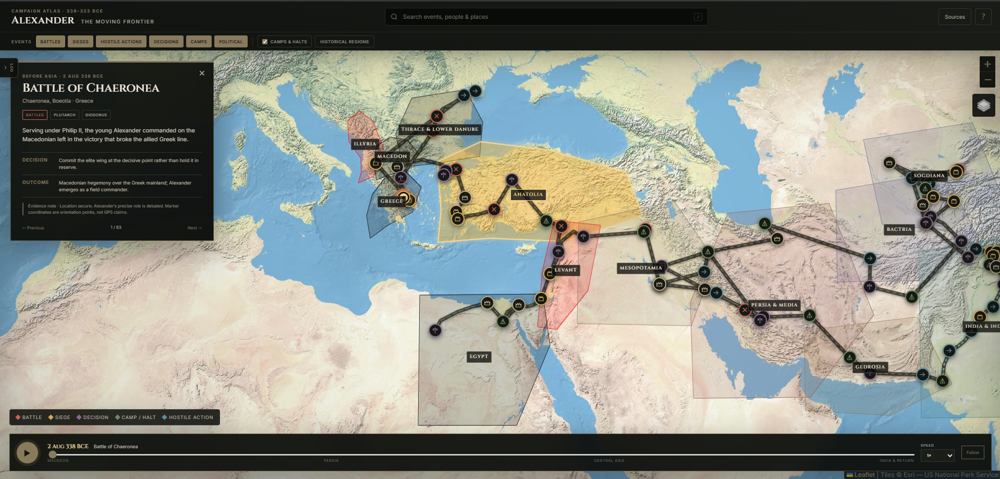

# Alexander · The Moving Frontier


An interactive historical atlas of Alexander the Great (Alexander III of Macedon), tracing his campaigns from Chaeronea in 338 BCE to his death in Babylon in 323 BCE. This is not a map of an empire at its maximum extent. It is a chronological reconstruction of decisions, battles, sieges, crossings, reversals, winter quarters, political settlements, and the long return from the Indus. The atlas is built around a simple rule: when the evidence is uncertain, the interface should say so instead of turning an ancient narrative into fake GPS precision.




## What is in the atlas

The current edition contains **83 episodes**, divided into:

| Episode type | Count |
|---|---:|
| Decisions | 20 |
| Camps and halts | 16 |
| Sieges | 13 |
| Hostile actions | 12 |
| Battles | 11 |
| Political events | 11 |

## Explore the atlas

**[Launch Alexander · The Moving Frontier ↗](https://1423thememelorder.github.io/alexander-the-moving-frontier/)**

### Run locally

Prefer to run the atlas on your own machine?

1. Download the repository using **Code → Download ZIP**.
2. Extract the downloaded archive.
3. Open `index.html` in your browser.


> **Note:** An internet connection is needed to load map tiles and external interface resources.

## Controls

| Input | Action |
|---|---|
| `Space` | Play or pause the campaign |
| `←` / `→` | Move to the previous or next episode |
| `/` | Focus search |
| `B` | Collapse or open the campaign log |
| Timeline slider | Jump directly to an episode |
| Follow Camera button | Keep or release the moving route marker |

## Repository layout

```text
.
├── index.html          # Interface structure and dialogs
├── styles.css          # Layout, map UI, responsive rules, and effects
├── app.js              # Events, sources, regions, map logic, and playback
└── region-colors.json  # Portable default palette for historical regions
```

## Historical basis

The source panel in the atlas links to the works used by the current event set:

### Ancient narratives

- [Arrian, *Anabasis of Alexander*](https://www.gutenberg.org/files/46976/46976-h/46976-h.htm)
- [Arrian, *Indica*](https://sourcebooks.web.fordham.edu/ancient/arrian-bookVIII-India.asp)
- [Plutarch, *Life of Alexander*](https://penelope.uchicago.edu/Thayer/E/Roman/Texts/Plutarch/Lives/Alexander*/3.html)
- [Diodorus Siculus, *Library of History*, Book XVII](https://penelope.uchicago.edu/Thayer/E/Roman/Texts/Diodorus_Siculus/17C*.html)

### Chronologies and reference material

- [Livius.org chronology of Alexander](https://test.livius.org/articles/person/alexander-the-great/alexander-the-great-5)
- [Encyclopaedia Britannica timeline](https://www.britannica.com/summary/Alexander-the-Great-Timeline)
- [Vincent A. Smith, chronology of the Indian campaign](https://www.ibiblio.org/britishraj/Jackson2/appendix02.html)
- [Alexander — Campaigns Atlas](https://alexander-ancien-atlas.com/battles.html)


## License

No licence. Publicly visible open-source.